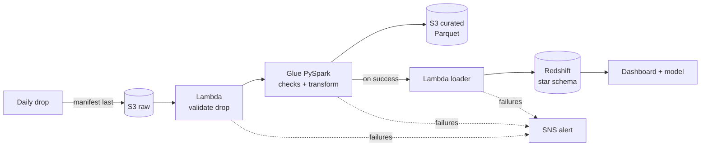

# 112 Last mile lateness pipeline

Daily batch pipeline on real Amazon delivery routes. It works out, for every package, whether the van likely reached the stop after the customer's delivery window closed, and which zones keep running late.

The cloud path is S3, Lambda, Glue (PySpark), Redshift Serverless and SNS, all in Terraform. The same code runs locally against LocalStack and Postgres, so you can run the whole thing on a laptop.



## Data

[Amazon Last Mile Routing Research Challenge](https://registry.opendata.aws/amazon-last-mile-challenges/) training set, CC BY-NC 4.0. About 6,100 routes from July and August 2018 across 17 stations in five US metros, with stops, packages, delivery windows, scan status, the order the driver actually drove and a travel time matrix.

The source is one snapshot, so `split_source.py` replays it as one drop per route date (39 days). That's what makes incremental loads, reruns and backfills meaningful here.

## What it does

1. **Land.** Upload a day's four JSONL files to `s3://raw/almrrc/dt=YYYY-MM-DD/`, then a `_manifest.json` with row counts, sizes and md5s.
2. **Validate the drop.** The Lambda fires only on the manifest, checks every file arrived at the right size and starts Glue for that date.
3. **Check and transform.** Spark runs the data checks first. Any ERROR check stops the run before anything is written. Then it estimates arrival time at each stop, flags late packages and writes three Parquet tables partitioned by route date.
4. **Load.** On Glue success, a second Lambda loads that date into Redshift with COPY plus delete and insert in one transaction.
5. **Use it.** Marts for station and zone lateness, a dashboard and a model that flags packages likely to miss their window.

Design decisions, the checks table, failure handling, SLA and cost notes are in [docs/design.md](docs/design.md).

## Results

Full backfill, all 39 days, on my laptop (Apple M2, 8 GB).

| | |
|---|---|
| Routes / packages loaded | 6,112 / 1,457,175 |
| Packages with a delivery window | 7.8% |
| Late against window (estimated) | 1.07% of windowed packages |
| Not delivered (attempted or rejected) | 0.76% |
| Time per day, land to warehouse | 23s average, 47s worst |
| Days loaded clean / with warnings / blocked | 18 / 21 / 0 |

The warnings were real source issues, not pipeline bugs. Packages with zero or negative dimensions showed up on 16 days. The volume check fired on 7 days. Two were in the first week while the dataset ramps up. Five were Aug 18 to 22, when routes per day drop from about 220 to about 40 to 70 and stay there, so the dataset's coverage thins out at the end. The check went quiet after five days because the trailing average caught up with the new level, which is the known weakness of that kind of check (see the design notes).

The zone mart is the useful output. A handful of zones run late at 3 to 5 times the network rate (for example DBO3 zone H-17.2E at 5.7% across 53 windowed packages), which is the list a station manager would act on.

The model is honest but weak. Trained on the first 30 days, tested on the last 9 (7,670 windowed packages, 0.7% late).

| | PR-AUC | ROC-AUC | Recall at 30% precision |
|---|---|---|---|
| Zone's historical late rate | 0.020 | 0.53 | 0.00 |
| Gradient boosting | 0.061 | 0.56 | 0.08 |

It's about 3x the baseline on PR-AUC, but lateness here is rare and mostly driven by things the features don't see before departure. The test days also fall in the thin end of the dataset, so the test set is small (53 late packages). I'd treat it as a ranking signal for which routes to watch, not something to act on per package.

## Run it

Needs Docker, Python 3.11 and Java 17 or 21.

```bash
make setup        # venv + .env
make up           # LocalStack S3 + Postgres
make data         # downloads ~2.3 GB once, writes 39 daily drops
make run DATE=2018-07-27
make backfill     # all 39 days, about 20 minutes on a laptop
make model        # trains on the earlier days, tests on the last 9
make dashboard
make test         # unit tests, no Docker needed
```

Rerun any day with `make run DATE=...`. It replaces that day and logs a new attempt in `ops.pipeline_runs`.

For AWS, `make package`, then `terraform apply -var-file=dev.tfvars` in `infra/terraform`. I've validated the Terraform but haven't left it deployed, since Redshift Serverless isn't free to keep around.

## Layout

```
src/lastmile/
  split_source.py    replay the snapshot as daily drops (streams the 1.8 GB file)
  landing.py         upload a drop, manifest last
  handler.py         Lambda trigger, validates the drop, starts Glue
  transform.py       Spark job, same file runs on Glue
  checks.py          data quality rules
  load.py            Postgres load (local)
  redshift_loader.py Lambda loader for Redshift
  runner.py          local orchestration, run / backfill / freshness
  model.py           lateness model
sql/postgres/        schema, ops tables, marts
sql/redshift/        Redshift DDL and the partition load
infra/terraform/     S3, Lambda, Glue, Redshift Serverless, EventBridge, SNS, alarms
dashboard/app.py     Streamlit
docs/design.md
```

## Limits

Arrival times are estimated from the driven stop order, the travel time matrix and planned service times. There are no GPS timestamps in the data. Only about 7% of packages have a delivery window, so lateness is measured on those. Good enough to find zones that keep running late. Not good enough to grade a single driver.
