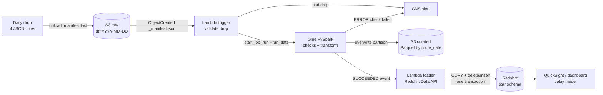

# Design notes

These are the decisions behind the pipeline and the things I'd want a reviewer to push on.

## Flow

Locally the same steps run in one process (`lastmile.runner`) against LocalStack S3 and Postgres. The transform, checks and SQL are the same code, only the launcher differs.

## Why the manifest goes last

S3 fires an event per object. If the Lambda listened to every file it would start Glue four times, sometimes before the other files had landed. The uploader writes `_manifest.json` after the data files, and the trigger only listens for that suffix. The Lambda then checks each listed file exists with the byte size the manifest claims, so a truncated upload is rejected before any Glue time is spent.

## Rerunning a day is safe

Every step is keyed on the route date.

* Curated Parquet is written with dynamic partition overwrite, so a rerun replaces `route_date=D` and nothing else.
* The warehouse load deletes that date's rows and inserts the new ones inside one transaction. A reader sees the old day or the new day, never half of each.
* Each attempt gets its own row in `ops.pipeline_runs`, so a rerun doesn't hide the failure before it.

I checked this by loading 2018-07-27 three times. Row counts stayed at 183 routes and 44,882 packages.

Backfill is the same code in a loop (`make backfill FIRST=... LAST=...`). In AWS the Glue job allows 4 concurrent runs, so a backfill can run several days at once because each run owns its own partition.

## Grain of the package fact

My first version keyed packages on (route, package). The uniqueness check failed on the first day with 42 duplicates. They weren't bad rows. A package can be attempted at one stop and delivered at another stop on the same route, for example a neighbour or a locker. So the grain is package x stop, and a separate WARN check tracks how often that happens (about 0.1% of packages a day). If it jumps, something upstream changed.

## How lateness is estimated

The source has the order the driver actually drove, a travel time matrix and planned service time per package. It has no GPS timestamps. Arrival at stop k is

departure + travel time of legs 1..k + service time at stops 1..k-1

A package is late when that estimate is after the end of its delivery window. Only about 7% of packages have a window at all, so the late rate is always reported over windowed packages. This is an estimate, and it doesn't capture time stuck in traffic beyond what the matrix says. I'd want real scan timestamps before using this for anything more than finding consistently slow zones.

## Data quality checks

ERROR checks stop the run before anything is written. WARN checks let the day through, get logged to `ops.dq_results` and send an alert.

| Check | Severity | Why |
|---|---|---|
| routes present, route date matches folder | error | an empty or misfiled drop would silently overwrite a good day |
| route_id unique, package x stop unique | error | duplicates double count lateness |
| station and departure time present | error | can't compute arrival without them |
| stop coordinates in range | error | cheap sanity check on the geo fields |
| every driven stop exists on the route | error | otherwise the arrival chain breaks |
| travel time coverage, at most 0.1% missing legs | error | a missing leg makes every later stop look early |
| package dimensions and service time positive | warn | a handful of packages a day have zero or negative dimensions in the source |
| delivery window end after start | warn | |
| route volume within 0.5x to 1.5x of the trailing 7 days | warn | catches a partial drop that is still valid JSON |
| packages at more than one stop under 2% | warn | see grain above |

The volume check fired on 2018-07-24 and 07-25 (about 1.6x the trailing average), while the dataset ramps up, and again on Aug 18 to 22, when routes per day fall from about 220 to about 40 to 70. It stopped firing after five days because the trailing 7-day average had caught up with the new level. That's the weakness of a trailing average. A sustained drop becomes the new normal within a week. A fix would be comparing against the same weekday over the last four weeks as well, or a fixed floor per station. I left it as is so the behaviour is visible in the run history.

## Spark notes

* One day is about 180 routes and 45k packages. With the default 200 shuffle partitions most tasks processed almost nothing. Setting 16 plus adaptive query execution took a day from about 70s to about 22s on my laptop. The setting is an env var because a multi-day job would want more.
* The travel matrix is read as `map<string, map<string, double>>` and looked up with `element_at`. Exploding it into one row per stop pair would be roughly 150 x 150 rows per route just to read about 150 legs.
* Raw JSON is read with an explicit schema and `FAILFAST`, so a malformed line fails the run instead of becoming a null row.

## Source file problems

* The challenge JSON contains bare `NaN` tokens for missing time windows, which isn't valid JSON. `split_source.py` streams the files and rewrites `NaN` to `null` on the fly. The first version of that wrapper split a `NaN` that landed on a read boundary. There's a test that feeds the parser 1 to 7 bytes at a time for exactly that reason.
* `travel_times.json` is 1.8 GB, so it is streamed with ijson instead of loaded whole.

## SLA and monitoring

* Target is that route date D is loaded by 06:00 UTC on D+1. `make freshness LAST=D` checks `ops.latest_runs` and alerts if D isn't loaded with status ok or warn. In AWS this would be a scheduled EventBridge rule calling the same check.
* Alerts go out for a rejected drop, a failed ERROR check, a Glue failure or timeout, and a failed Redshift load. Locally they go to the log and an optional webhook.

## Cost, rough

At this volume (about 45k packages a day) a daily run is small.

* Glue, 2 G.1X workers for a few minutes. The 1 minute minimum billing applies, so roughly a few cents to tens of cents a day.
* Redshift Serverless at the 8 RPU floor, billed only while the load and queries run.
* S3 is negligible. Raw moves to Glacier Instant Retrieval after 90 days since it's only re-read for backfills.

If volume grew 100x, I'd look at Glue worker count and partitioning the facts by station as well as date before anything else.

## What I'd do next

* Use the planned stop sequence for the model's position feature. Right now it uses the driven order, which wouldn't be known at departure.
* Move the dimension upserts to proper SCD2 for stations, if station attributes start changing.
* Add a scheduled freshness Lambda in Terraform instead of only the make target.
* Store the check thresholds in config so they can be tuned without a deploy.
